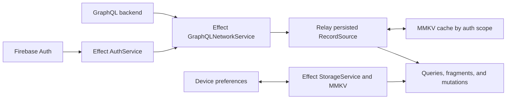

# Data Flow Architecture

**Status:** Accepted
**Updated:** 2026-09-26
**Decision:** Relay-centric server state with Effect service boundaries and MMKV persistence

## Context

Relay owns GraphQL server data, with MMKV persistence and Effect service boundaries. The SignalDB cache and TanStack Query mutation wrappers have been removed. Jotai, Legend State, and the Effect atom registry still coexist; their consolidation is still pending.

## Decision

Relay is the single client-side source of truth for GraphQL server state.

- Components read server data through Relay queries and fragments.
- Components write server data through Relay mutations.
- `GraphQLNetworkService` remains the Effect-managed network boundary for auth, caching metadata, tracing, and errors.
- Relay's `RecordSource` is persisted to MMKV and isolated by authentication scope.
- Device-only preferences remain in MMKV through the existing storage service and registry.
- Firebase authentication remains behind the Effect auth service.
- Firestore is legacy-only. Do not add new Firestore reads; migrate the remaining reads when their owning features are changed.

The TanStack DB direction is rejected. It would introduce another cache and sync layer while stranding the existing Relay schema, generated artifacts, and Effect network-service investment.



## Ownership rules

| State                          | Owner                                   | Persistence                     | UI access                                          |
| ------------------------------ | --------------------------------------- | ------------------------------- | -------------------------------------------------- |
| GraphQL server data            | Relay                                   | MMKV-backed RecordSource        | `useLazyLoadQuery`, `useFragment`, Relay mutations |
| Network/auth/cache policy      | Effect services                         | Service-specific                | Service APIs; no direct component wiring           |
| Theme and device preferences   | StorageService/MMKV                     | MMKV                            | A small external-store hook or feature hook        |
| Authentication session         | Firebase through AuthService            | Firebase native persistence     | Auth hooks/providers                               |
| Local component state          | React                                   | None unless explicitly required | `useState`, `useReducer`, `useRef`                 |
| Cross-screen navigation intent | Router params or a small external store | Only when required              | Feature-specific hook                              |

Do not introduce a new state library without an architecture decision that identifies the state owner, persistence contract, and removal plan for the displaced owner.

## Persistence and freshness operations

Persistence defaults on. After Statsig initializes, `relay_persistence_killswitch` writes the inverse value to the next-launch latch. Enabling the gate clears persisted Relay records and disables persistence on the next launch; disabling it re-enables persistence on the next launch. Use it for cache recovery, with the loss of offline cached data understood.

Retention restores eligible cached queries regardless of age. Authentication scope, cache version, record availability, variant caps, and hydration size limits still apply. Environment disposal cancels its active requests and revokes its storage lease so late writes cannot modify a later session's cache.

The foreground revalidator sweeps allowlisted queries on foreground and connectivity recovery, with a 60-second cooldown and no sweeps while offline. It also works when persistence is disabled. Statsig's `relay_revalidation_config` is read at sweep time:

```json
{
  "defaultWindowMs": 300000,
  "windows": { "CampusesQuery": 86400000 },
  "cacheGeneration": 1
}
```

- `defaultWindowMs` defaults to five minutes. `windows` overrides it by operation name; only allowlisted operations participate. Zero makes a previously fetched entry due on the next eligible sweep. Invalid windows fall back to the default.
- To force refresh after a CMS update, advance `cacheGeneration` to a new value. Devices compare it with their saved generation on the next eligible sweep; fresh installs establish a baseline. A changed generation is saved only after the whole sweep succeeds, so failures remain retryable.
- To reduce automatic refresh frequency, increase both the default window and any shorter per-query overrides. A generation change still forces a sweep. Statsig delivery and the sweep cooldown bound how quickly configuration takes effect.

The implementation and query allowlist live in [foregroundRevalidation.ts](../../src/relay/foregroundRevalidation.ts) and [offlineQueryRetention.ts](../../src/relay/offlineQueryRetention.ts). Future server-triggered freshness options are described in [Server-Driven Freshness](2026-08-17-server-driven-freshness.md).

## Profile provisioning

Mobile's `ensure_user_profile_enabled` gate defaults off. The provisioning helper retries once; disabled or failed calls fall back to the legacy Firestore wait in the sign-in flows. Preserve that fallback until its rollout is explicitly retired. Backend repair, enrichment, and open-app profile refresh are documented in the [onboarding queue runbook](../../../server/docs/onboarding-queue.md).

## Remaining work and verification

Lifecycle ownership, refresh-policy coverage, state-library consolidation, and measured persistence/payload optimization are still open work. Changes to those boundaries must preserve:

- online behavior and warm-cache airplane-mode startup;
- account isolation, including late responses after sign-out or an account switch;
- visible loading, error, retry, and mutation states;
- durable push-registration commands across process termination;
- root typecheck, lint, formatting, and relevant tests.
