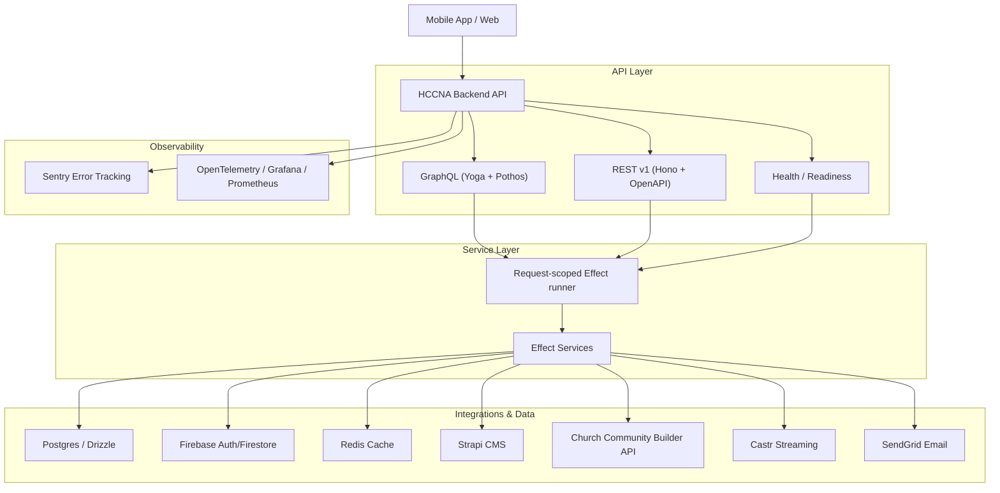

# HCCNA Backend

The HCCNA Backend is a robust API serving as the central hub for the church organization's mobile application. It orchestrates various integrations, provides both REST and GraphQL interfaces, and is built for high performance using the Bun runtime.

## Architecture



The backend is in an Effect-first migration. Hono and GraphQL Yoga are transport adapters; application behavior, config, caching, auth, external I/O, and workflow logic should move behind Effect services. See [docs/architecture-map.md](docs/architecture-map.md) for the detailed project map and [CONTEXT.md](CONTEXT.md) for domain language.

## Tech Stack

| Category | Technology |
| :--- | :--- |
| **Runtime** | Bun 1.3.x |
| **Web Framework** | Hono, @hono/zod-openapi, Effect |
| **GraphQL** | GraphQL Yoga, Pothos |
| **Data Stores** | Postgres, Redis, Firebase Firestore |
| **Integrations** | Strapi CMS, CCB (Church Community Builder), Castr (Streaming), SendGrid |
| **Observability** | Sentry, OpenTelemetry, Prometheus, Grafana, Pino |
| **Testing/Linting** | Vitest, Oxlint, Oxfmt, Knip |

## Prerequisites

- **Bun**: Ensure Bun 1.3.5 or higher is installed.
- **Docker**: Required for running Redis locally if not using a managed instance.

## Getting Started

1.  **Install dependencies**:
    ```bash
    bun install
    ```

2.  **Environment Setup**:
    Copy the example environment file and fill in the required credentials.
    ```bash
    cp .env.example .env
    ```

3.  **Run Development Server**:
    ```bash
    bun run dev
    ```
    - The main app runs on `http://localhost:8080`
    - The metrics server runs on `http://localhost:9184`

## API Endpoints

| Endpoint | Description |
| :--- | :--- |
| `/graphql` | GraphQL interface (Yoga + Pothos) |
| `/v1/*` | REST API v1 (Hono + OpenAPI) |
| `/reference` | Interactive API documentation (Scalar) |
| `/openapi.json` | OpenAPI 3.0 specification |
| `/healthz` | Liveness check |
| `/readyz` | Readiness check for runtime dependencies |
| `/metrics` | Prometheus metrics (port 9184) |

## Project Structure

- `src/effect/`: Effect-based services, runtime configuration, and utility layers.
- `src/generatedTypes/`: TypeScript definitions automatically generated from external services (e.g., Strapi).
- `src/graphql/`: GraphQL schema definitions, resolvers, and Pothos builder configuration.
- `src/routes/`: REST API route definitions for versioned endpoints.
- `src/utils/`: Shared utilities, integration clients (Firebase, CCB, Castr), and middleware.
- `src/index.ts`: Application entry point and server lifecycle management.
- `src/app.ts`: Hono application initialization and global middleware configuration.

## Available Scripts

- `bun run dev`: Starts the development server with hot reloading.
- `bun run start`: Starts the production server.
- `bun run start:container`: Starts the container entrypoint used by Docker.
- `bun run build`: Runs type checking using `tsc`.
- `bun run test`: Executes the test suite using Vitest.
- `bun run lint`: Runs Oxlint and the repository policy checks.
- `bun run prettier:fix`: Formats the codebase according to project standards.
- `bun run knip`: Finds unused files, dependencies, and exports.
- `bun run db:migrate:deploy`: Runs pending database migrations once (same as `db:migrate:run`).

## Development Guidelines

- **Imports**: Use absolute paths with the `@/` alias (e.g., `@/utils/constants`).
- **REST Routes**: Define routes using `createRoute` from `@hono/zod-openapi` for automatic documentation.
- **Type Safety**: Use Zod for runtime validation and schema inference.
- **Service Layer**: Prefer the `Effect` library for complex error handling and dependency management in new services.
- **Naming**: Use `PascalCase` for Schemas and `camelCase` for variables and functions.

## Deployment

The project is designed to be deployed as a Docker container.
- **Docker**: Use the provided `Dockerfile` and `docker-compose.yml`.
- **Railway**: Production runs on Railway. The `deploy server` workflow (`.github/workflows/deploy-server.yml`) deploys pushes to `main` that touch the server; pull requests only build the image.
- **Stellate**: GraphQL caching is managed via Stellate (see `stellate.ts`).

### Migration Strategy

- Production migrations run only when the owner dispatches the "Drizzle Migrations CI" workflow (`.github/workflows/drizzle-migrations.yml`), which runs `bun run db:migrate:run` against the Railway database. Deploys, pushes, and pull requests never migrate.
- The container entrypoint runs migrations on startup unless `RUN_MIGRATIONS=false`. Railway sets `RUN_MIGRATIONS=false`, so production instances never migrate on boot; local and generic Docker startup migrate by default.
