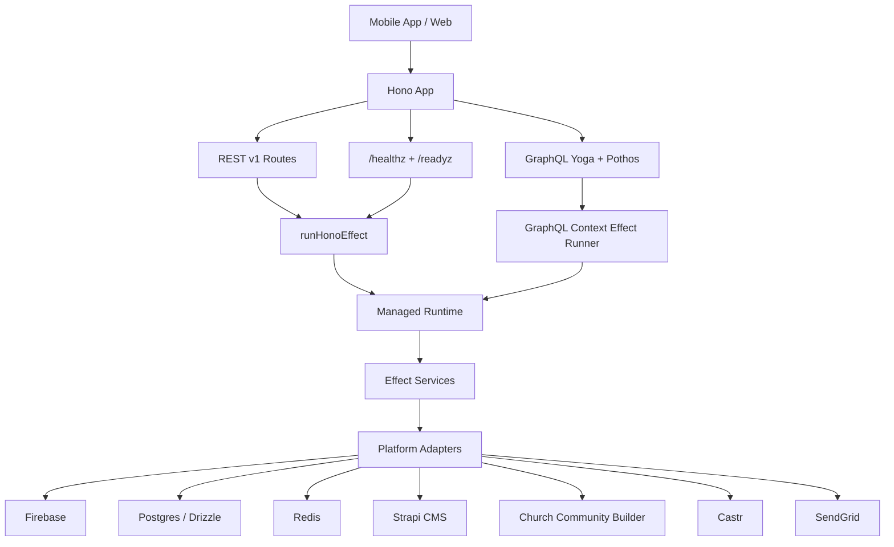

# Architecture Map

This map explains where the main backend responsibilities live. For domain language, use [`../CONTEXT.md`](../CONTEXT.md). For durable decisions, use [`adr/`](./adr/).

## Runtime Shape

The backend is a Bun application with Hono as the HTTP shell and GraphQL Yoga/Pothos as the GraphQL transport. The target architecture is Effect-first: Hono and Yoga should stay thin, while application behavior, config, caching, auth, external I/O, and workflow logic move behind Effect services.

## Where To Look

- `src/index.ts`: process entrypoint, runs `Main` through the managed runtime and disposes the runtime on shutdown.
- `src/effect/Main.ts`: scoped application lifecycle for API server, metrics server, Statsig, and shutdown signal handling.
- `src/effect/Runtime.ts`: application layer composition and managed runtime creation.
- `src/effect/AppConfig.ts`: typed runtime configuration loaded through Effect `Config`.
- `src/effect/requestExecution.ts`: central request execution bridge into the managed runtime.
- `src/transport/http/honoEffectRunner.ts`: Hono transport adapter for Effect programs.
- `src/graphql/context.ts`: GraphQL request context, auth, Statsig, loaders, and request-scoped Effect runners.
- `src/effect/services/`: Effect service layer and platform/business capabilities.
- `src/routes/v1/`: REST v1 routes.
- `src/graphql/schema/`: GraphQL schema and resolver modules.
- `src/db/`: Drizzle schema and database access.
- `src/platform/`: cross-cutting platform concerns such as observability and config helpers.

## Current Exemplar

`AttendanceExportService` plus `src/effect/services/attendanceExport/*` is the current model for a larger backend capability:

- public service entrypoint: `src/effect/services/AttendanceExportService.ts`
- capability-local types and helpers: `src/effect/services/attendanceExport/*`
- focused service tests: `src/effect/services/__tests__/AttendanceExportService.test.ts`

When other capabilities grow, prefer this shape over adding more broad utilities.

## Boundary Rules

- Effects execute at application or transport boundaries, not inside business logic.
- Hono handlers that execute Effects use `runHonoEffect`.
- GraphQL resolvers use the request-scoped `ctx.effect` runner during migration.
- Promise-based callback adapters may execute Effects internally only when the adapter object itself is the boundary.
- Firebase follows the vendored Effect platform-client pattern: low-level platform services may wrap raw clients, but business code should depend on narrow Effect services.
- Runtime config belongs in `AppConfig` or narrower config services, not direct `process.env`.
- New Effect service errors use `Schema.TaggedError`.
- Important cross-system IDs should become branded Schema types incrementally at service/domain boundaries.

The active guardrail is `scripts/check-effect-boundaries.ts`, which ratchets new violations while explicitly listing current migration debt.

## ADRs

- [`0001-effect-service-style.md`](./adr/0001-effect-service-style.md): use `Context.Service` plus explicit `Live` layers.
- [`0002-effect-execution-boundaries.md`](./adr/0002-effect-execution-boundaries.md): execute Effects only at approved boundaries and ratchet migration debt.
- [`0003-firebase-boundary.md`](./adr/0003-firebase-boundary.md): wrap Firebase behind platform and focused Effect services.

## Migration Direction

The codebase is in an intentional transition. Do not reorganize the whole backend in one churn-only PR. Apply the target structure when materially changing a capability.

Current capability reshaping priority:

1. CMS
2. Giving
3. Streaming
4. Verse of the Day

Attendance export remains the exemplar. GraphQL attendance should become thinner by delegating more behavior to its existing service shape.
