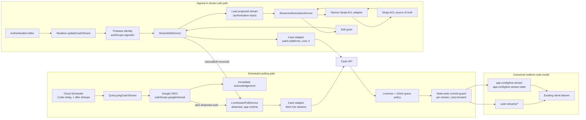

# Streaming Migration Implementation Plan (v3)

Supersedes v2 (and v1). v2 corrected v1's description of the system; v3 corrects v2's own
specifications after a second adversarial pass — chiefly a dependency inversion in the authorization
contract, an aggregate-corruption bug in the stale-write guard as previously specced, and an
undefined term (`changesMetadata`) that would have broken every edit under Phase B.

Every claim about current _code_ behavior is cited to a file and line. Claims about deployed
infrastructure are marked as observations and must be re-verified via the Phase 0 snapshot before
anything acts on them.

## Changes from v2

| #   | v2 said                                                                       | Defect                                                                                                                 | v3 resolution                                                                                  |
| --- | ----------------------------------------------------------------------------- | ---------------------------------------------------------------------------------------------------------------------- | ---------------------------------------------------------------------------------------------- |
| 1   | `authorizeEdit` returns `allowedPlatformIds` derived from projected platforms | Its inputs carry no platform list, and the projection loads _after_ authorize in the edit sequence                     | Edit sequence reordered: load projection first, pass `knownPlatformIds` into authorize         |
| 2   | Stale-write guard "skips that stream's projection writes"                     | The transaction replaces the `live-stream.streams` array wholesale; a skip would drop the stream from the aggregate    | Guard spec now requires carrying skipped streams' previous entries and markers forward         |
| 3   | `snapshotObservedAt` = "timestamp captured before the Castr fetch"            | `getLiveStreams` can serve a Redis entry up to 5s old written by another instance; pre-fetch time ≠ observation time   | Stated as an approximation, acceptable because skew ≤ the 5s Castr cache TTL                   |
| 4   | B2 gates on "metadata is requested without permission"                        | `title`/`description` are `required: true`, so every command "requests metadata"; naive B2 rejects all unchanged edits | `changesMetadata` defined as _differs from the projected document_                             |
| 5   | (testing strategy absent; v1's demanded emulator tests)                       | No Firestore emulator exists; the harness is an in-memory mock whose `runTransaction` never retries or contends        | Honest testing section: what fakes prove, what they cannot, and the contention-hook compromise |
| 6   | `run()` takes `streamId`/`isEndingStream` _and_ `overrideIsLive`              | Two overlapping encodings of "a manual edit happened" invite drift                                                     | Folded into one `manualEdit` input                                                             |
| 7   | `unauthorizedPlatformPolicy` is a caller-passed parameter                     | Nothing says who decides or how B1 rolls out/reverts                                                                   | Wired from `AppConfig`; revert is a config change; Statsig gate optional for gradual rollout   |

v2's corrections of v1 all stand and are folded in below: the two-layer auth-denial contract, the
five-minute `castrStream` response-cache hole, the load-bearing post-poll `isLive` override, the
stale-write ordering gap, the B1–B4 enumeration, the two-scheduler observation, and the Phase 0
infrastructure snapshot.

## Status and constraints

This document is the implementation plan for moving streaming business logic out of GraphQL
resolvers and into Effect services.

Fixed decisions:

- Preserve the existing GraphQL schema, operation names, arguments, result unions, and response
  shapes.
- Preserve the existing Cloud Scheduler request payload. Scheduler continues to call the protected
  `pingCastrStream` GraphQL query, authenticated with Google OIDC, gated by
  `authScope.googleInternal`.
- `pingCastrStream` may acknowledge immediately after starting detached background work. A background
  failure is reported to Sentry and structured logs; it is not propagated back to Scheduler.
- Firestore remains the canonical realtime read model. Existing clients keep their current listener.
- Strapi remains the source of truth for stream-editing access-control data.
- GraphQL continues to enforce Firebase signed-in identity for user-facing stream reads and edits.
- No Postgres, backend GraphQL subscriptions, WebSockets, or Scheduler retry orchestration.

**Phase A is parity; Phase B is a short, enumerated list of deliberate behavior changes**, each
separately decidable and revertable:

- **B1 — platform tightening**: reject the whole command when any requested platform is outside the
  grant (today: silent filtering).
- **B2 — metadata gating**: persist metadata only when the command _changes_ metadata and the grant
  allows it (today: unconditional once ≥1 patch succeeds). See the `changesMetadata` definition.
- **B3 — post-commit semantics**: reconciliation failure after Castr/metadata committed returns
  success + Sentry (today: a GraphQL error for a succeeded edit).
- **B4 — duplicate-input rejection**: conflicting duplicate platform entries become an invalid
  command (Phase A: deterministic last-occurrence-wins).

## Verified current behavior

Cited so parity tests are written against facts rather than recollection.

### `Query.castrStream` — [stream.ts:349](../src/graphql/schema/castr/stream.ts#L349)

- Requires `authScope.signedIn`; returns `CastrStream`, **nullable** in
  [schema.graphql:523](../schema.graphql#L523).
- **Two denial layers with different wire shapes.** A caller who is not signed in never reaches the
  resolver: the Pothos scope plugin ([builder.ts:99-113](../src/graphql/builder.ts#L99)) rejects with
  a **GraphQL auth error**, asserted by
  [castrStream.test.ts:144-151](../src/graphql/__tests__/queries/castrStream.test.ts#L144). For a
  signed-in caller, resource-level failure returns `undefined` — surfacing as **`null`**, not an
  error — for: no Strapi ACL match ([:371](../src/graphql/schema/castr/stream.ts#L371)) and missing
  Firestore doc ([:379](../src/graphql/schema/castr/stream.ts#L379)). **ACL denial and not-found are
  indistinguishable to a signed-in client.**
- The `!ctx.currentUserEmail` guard ([:363](../src/graphql/schema/castr/stream.ts#L363)) is
  unreachable defense: the `signedIn` scope already requires `currentUserEmail`. Keep it; it is not a
  contract.
- Reads Strapi with `{ fresh: true }`, bypassing the 10-minute LRU and 70-minute Redis caches
  ([StrapiService.ts:20-21](../src/effect/services/StrapiService.ts#L20),
  [:283](../src/effect/services/StrapiService.ts#L283)).
- **But the field is response-cached per session for five minutes** —
  `"Query.castrStream": FIVE_MINUTES_MS` ([graphql.ts:181](../src/routes/graphql.ts#L181)). A cache
  hit skips the resolver and its fresh read entirely, serving pre-revocation platform visibility and
  `stream_key`s to the same token. Phase A closes this (step 8).
- `castrPlayerUrl` comes from the hardcoded `streamSlugMapping`
  ([StreamMappingService.ts:16-52](../src/effect/services/StreamMappingService.ts#L16)), not Strapi.
- `CastrPlatform.channel_name` carries the **stream's** name, not the platform's
  ([:403](../src/graphql/schema/castr/stream.ts#L403)). Preserve the wire value; see Glossary.

### `Query.pingCastrStream` — [stream.ts:412](../src/graphql/schema/castr/stream.ts#L412)

- **Auth denial is a GraphQL auth error, not the union.** The `googleInternal` scope is enforced
  pre-resolver; anonymous and merely-`authorized` callers get a GraphQL auth error
  ([castrStream.test.ts:349-360](../src/graphql/__tests__/queries/castrStream.test.ts#L349)). The
  resolver's own `authType` branch returning `PingCastrStreamQueueError{message:"Unauthorized"}`
  ([:417-422](../src/graphql/schema/castr/stream.ts#L417)) is **unreachable defense-in-depth** — keep
  the branch; it is not a wire contract and needs no parity test.
- Detached execution already uses a request-independent lifecycle:
  [context.ts:127-131](../src/graphql/context.ts#L127) builds a `detachedRequestContext` with a fresh
  `AbortController().signal`; [requestExecution.ts:48](../src/effect/requestExecution.ts#L48) runs on
  the app-wide `managedRuntime`.
- Background failures are logged but **not** sent to Sentry today
  ([:314-322](../src/graphql/schema/castr/stream.ts#L314)).

### `Mutation.updateCastrStream` — [stream.ts:464](../src/graphql/schema/castr/stream.ts#L464)

Ordered, because ordering is load-bearing:

1. Fresh Strapi ACL read; mismatched `streamId` throws `"Castr stream not found"`
   ([:486-489](../src/graphql/schema/castr/stream.ts#L486)).
2. The authorized platform set is derived from the **Firestore projection's** platform list filtered
   by Strapi `excludeIDs` ([:507-511](../src/graphql/schema/castr/stream.ts#L507)) — the projection
   read is an authorization input, not just display data.
3. Unauthorized platforms are **silently filtered out**
   ([:512-514](../src/graphql/schema/castr/stream.ts#L512)); it only throws when _every_ requested
   platform is unauthorized ([:516-519](../src/graphql/schema/castr/stream.ts#L516)).
4. `title` and `description` are **required inputs** ([:444-446](../src/graphql/schema/castr/stream.ts#L444)) —
   every command carries metadata values whether or not they changed. The push-notification gate
   already computes "changed" by diffing against the projection ([:524](../src/graphql/schema/castr/stream.ts#L524)).
5. Castr patches run via `Promise.allSettled` — unbounded concurrency
   ([:550](../src/graphql/schema/castr/stream.ts#L550)); duplicate entries for one platform race
   nondeterministically.
6. All patches failing throws; a partial failure reports to Sentry and continues
   ([:591-602](../src/graphql/schema/castr/stream.ts#L591)).
7. `title`/`description`/`last_updated` are written **unconditionally** once ≥1 patch succeeded —
   including for platforms whose patch failed — via `.update()`, which throws on a missing document
   ([:611-615](../src/graphql/schema/castr/stream.ts#L611)).
8. `updateStreamMapping({trigger:"manual-mutation", ...})` is awaited
   ([:627](../src/graphql/schema/castr/stream.ts#L627)).
9. `updateLiveStreamConfigStatus` is awaited **after** the poll
   ([:628](../src/graphql/schema/castr/stream.ts#L628)), deliberately overwriting the poll's `isLive`
   for this stream with `getLiveStatusAfterSuccessfulPlatformUpdates`
   ([:86-100](../src/graphql/schema/castr/stream.ts#L86)).

Step 9 exists because `isChannelLive` treats `enabled` as live and Castr reports `enabled` before it
is truly offline ([StreamMappingService.ts:150-153](../src/effect/services/StreamMappingService.ts#L150)).
**Without the override, ending a stream can be immediately re-marked live by the poll in the same
request.**

Steps 8–9 run _after_ Castr and Firestore were already mutated, and both are awaited: either throwing
returns a GraphQL error for an edit that already succeeded.

### Polling — [StreamMappingService.ts](../src/effect/services/StreamMappingService.ts)

- Grace period `OFFLINE_GRACE_PERIOD_MS = 10 * 60 * 1000` ([:144](../src/effect/services/StreamMappingService.ts#L144)).
- Projection is transactional across `app-config/live-stream`, `app-config/live-stream-state`, and
  `castr-streams/*` ([:435-565](../src/effect/services/StreamMappingService.ts#L435)), with merge
  writes and grace-state continuity. The `live-stream.streams` **array is replaced wholesale** each
  run from the current snapshot ([:538-544](../src/effect/services/StreamMappingService.ts#L538)) —
  a fact the stale-write guard must respect (see guard spec).
- Ended-platform reconciliation is bounded at concurrency 4 ([:148](../src/effect/services/StreamMappingService.ts#L148));
  Castr 404/409 are treated as non-fatal skips ([:161-162](../src/effect/services/StreamMappingService.ts#L161)).
- **Atomicity exists; ordering protection does not.** `now` is captured before the transaction opens
  ([:434](../src/effect/services/StreamMappingService.ts#L434)); the stored `lastCheckedAtByStreamId`
  is read only to estimate grace-period start ([:486](../src/effect/services/StreamMappingService.ts#L486))
  and overwritten unconditionally ([:519](../src/effect/services/StreamMappingService.ts#L519)). An
  older Castr snapshot committing after a newer run silently overwrites it.

### Castr adapter — [CastrService.ts](../src/effect/services/CastrService.ts)

- `getLiveStreams` is cached ~5 seconds in memory and Redis (`CACHE_TTL_SECONDS = 5`,
  stale-refresh at 3s; [:21-24](../src/effect/services/CastrService.ts#L21)), and can serve a Redis
  entry written by another instance. `invalidateLiveStreamsCache` clears both
  ([:170-175](../src/effect/services/CastrService.ts#L170)); the poll invalidates before fetching
  ([StreamMappingService.ts:622](../src/effect/services/StreamMappingService.ts#L622)).
- Note: [caching-strategy.md](caching-strategy.md)'s policy table says `castr` = 300s. The code says
  5s. The code wins; the strategy doc has drifted and should be corrected separately.

## Production facts the plan must account for

Unlike the rest of this document, the facts in this section are **not repository-citable** — they
come from production `gcloud` observation (August 2026). Phase 0 records a dated, read-only
infrastructure snapshot (step 0a) before anything acts on them.

**Two schedulers, not one** (observed Aug 2026). `CastrPoll` (direct service URL) and
`CastrStreamPoll` (public API domain) both invoke `pingCastrStream` every ten minutes. Overlapping
polls are the steady state.

**The grace period equals the cadence.** A stream gets roughly one confirming poll before expiry —
and with two racing pollers, _which_ poll wins can decide whether a stream ends.

- Deduplicating the scheduler jobs is a **prerequisite** (step 0a). Decide whether the survivor is
  the public-domain job (exercises the real proxy path) or the direct service-URL job.
- Dedupe reduces overlap; it does not eliminate it. Cron-vs-manual overlap remains by design, and a
  slow poll can overlap the next tick. Ordering safety comes from the application-level stale-write
  guard, never from scheduler topology.
- Leave the grace period at 10 minutes for this migration; record the cadence coupling as a known
  constraint.

**Shutdown interrupts detached work; it does not drain it.** `Main` returns on SIGTERM
([Main.ts:33](../src/effect/Main.ts#L33)); `index.ts` then calls `managedRuntime.dispose()`
([index.ts:12](../src/index.ts#L12)), interrupting in-flight detached fibers. An interrupted poll
publishes nothing partial (the transaction is atomic); the next poll converges. Cloud Run runs
`min instances = 1`, so this occurs only on deploys and crashes. **Accepted; no drain is built.**

**Latency budget.** `APP_TIMEOUT_MS = 20_000` equals the Castr client's per-attempt timeout, so an
upstream hang becomes a 504 with no Castr error logged. `updateCastrStream` must fit a fresh Strapi
read + N Castr patches + a full poll + the aggregate write inside 20 seconds. Bound patch concurrency
at 4 (matching `ENDED_STREAM_DISABLE_CONCURRENCY`) and record p95 edit duration before and after.

## Target architecture

GraphQL becomes a thin transport boundary: authenticate, convert input to a service command, execute
through the request runner, map typed failures to the existing response or error shape.



The acknowledgement means only that background work was started, not that Castr was reachable or
Firestore updated.

## Service responsibilities

Follow [ADR 0001](adr/0001-effect-service-style.md) (`Context.Service` + explicit `Live` layer),
[ADR 0002](adr/0002-effect-execution-boundaries.md) (execute only at boundaries), and
[ADR 0003](adr/0003-firebase-boundary.md) (Firebase behind focused services).

### `LiveStreamPollService`

```ts
interface LiveStreamPollServiceContract {
	readonly run: (input: {
		readonly trigger: "cron" | "manual-mutation";
		/**
		 * Present only for trigger "manual-mutation": the single source of truth for
		 * "an edit just happened to this stream". Replaces v2's overlapping
		 * streamId / isEndingStream / overrideIsLive fields.
		 */
		readonly manualEdit?: {
			readonly streamId: string;
			/** Every updated platform went offline — force manual-ended state. */
			readonly isEnding: boolean;
			/** isLive computed from the successful platform updates; wins over the snapshot. */
			readonly isLive: boolean;
			readonly sendPushNotification: boolean;
		};
	}) => Effect.Effect<LiveStreamPollSummary, LiveStreamPollError>;
}
```

Responsibilities — present in `StreamMappingService` today and preserved:

- Invalidate the Castr cache, then fetch a fresh snapshot; fail on an empty snapshot.
- Decode provider responses at the adapter boundary; map provider failures to typed errors.
- Apply the existing liveness and offline-grace policy unchanged.
- Persist the per-stream and aggregate projection in one Firestore transaction with merge writes,
  preserving grace-state continuity.
- Reconcile ended Castr platforms at bounded concurrency; 404/409 are non-fatal skips.
- Send the optional House of Stars push notification; notification failure is logged, not fatal.

**Stale-write commit guard (new work).** Today nothing rejects an out-of-order commit. Specification:

- Capture `snapshotObservedAt` immediately before `invalidateLiveStreamsCache` + fetch. This is an
  **approximation** of observation time: `getLiveStreams` may serve a Redis entry up to 5 seconds old
  from another instance, but the poll invalidates first and the Castr cache TTL (5s) is far below any
  contention window this guard arbitrates, so pre-fetch wall clock is an accepted proxy. Do not
  thread `cachedAt` through the adapter for this.
- Persist the committed `snapshotObservedAt` per stream in `live-stream-state` alongside the existing
  markers.
- Inside the transaction, per stream: if the stored `snapshotObservedAt` is **newer** than this
  run's, the stream is stale for this run. A stale stream contributes **its previous state, not
  nothing**: its existing `live-stream.streams` entry is carried into the rebuilt array unchanged,
  its `castr-streams` doc is not written, and its grace markers are untouched. This matters because
  the transaction replaces the `streams` array wholesale
  ([:538-544](../src/effect/services/StreamMappingService.ts#L538)) — a naive "skip the writes" would
  silently delete the stream from the aggregate and clients would watch it vanish.
- Count skipped streams as `staleSkipped` in the summary.
- The `manualEdit.isLive` write is **exempt** from the guard: it encodes explicit user intent from a
  just-completed Castr mutation, not a provider snapshot, and must win over any concurrent cron run.
- The guard is application-level and deliberately independent of scheduler topology and of Scheduler
  retry orchestration (still a non-goal). Firestore transaction retries give atomicity and
  serialization; the guard adds the ordering serialization alone does not.

Applying `manualEdit.isLive` inside this same transaction (rather than today's separate post-poll
write) removes the read-modify-write race between `updateStreamMapping` and
`updateLiveStreamConfigStatus` while preserving identical observable outcomes.

Emit a structured summary: trigger, `pollRunId`, `snapshotObservedAt`, start/finish, stream count,
transition counts, `staleSkipped` count, transaction outcome, provider latency, reconciliation
failures.

`StreamMappingService` may be retained as a compatibility wrapper during migration; GraphQL must end
up depending on `LiveStreamPollService`.

### `StreamAuthorizationService`

```ts
interface StreamEditGrant {
	readonly streamId: string;
	readonly allowedPlatformIds: ReadonlySet<string>;
	readonly canEditMetadata: boolean;
}

interface StreamAuthorizationServiceContract {
	readonly authorizeEdit: (input: {
		readonly principalEmail: string;
		readonly campusSlug: string;
		readonly claimedStreamId: string;
		/**
		 * Platform IDs of the projected stream, loaded by the caller BEFORE authorizing.
		 * The allowed set is knownPlatformIds minus Strapi excludeIDs — matching today's
		 * derivation from the Firestore doc (stream.ts:507-511). Without this input the
		 * grant cannot be computed (v2's contract had the dependency inverted).
		 */
		readonly knownPlatformIds: readonly string[];
		readonly requestedPlatformIds: readonly string[];
		/** True only when the command's title/description DIFFER from the projected document. */
		readonly changesMetadata: boolean;
	}) => Effect.Effect<StreamEditGrant, StreamAuthorizationError>;
}
```

Responsibilities:

- Require a normalized, non-empty principal email from the authenticated request context.
- Resolve the ACL through the narrow Strapi adapter with a source-fresh read.
- Verify the client-supplied `streamId` exactly matches the Strapi-owned stream ID for the slug.
- Derive `allowedPlatformIds` = `knownPlatformIds` minus the matching coordinators' union of
  `excludeIDs`.
- Enforce metadata permission separately from platform permission. Under today's Strapi model a
  matching coordinator has `canEditMetadata: true`; finer granularity must be introduced in Strapi
  and interpreted only by the adapter.
- Apply the unauthorized-platform policy (below): `"filter"` narrows the requested set; `"reject"`
  fails the grant when any requested platform is outside the allowed set, or `changesMetadata` is
  true without metadata permission.
- Fail closed on unavailable, malformed, missing-stream, or no-matching-coordinator conditions.
- Return typed internal errors; the resolver preserves the public error shape.

**Policy wiring (resolves v2's open question of who decides).** `unauthorizedPlatformPolicy` is not a
caller-passed parameter; it is read from `AppConfig`
(`STREAM_EDIT_UNAUTHORIZED_PLATFORM_POLICY`, default `"filter"`). Flipping B1 on — and reverting
it — is a config change, not a deploy. If gradual rollout is wanted, gate per-principal via the
existing Statsig facade (`checkGate` is already on the request context) with the config value as
fallback; this is optional machinery, not a requirement.

### Narrow Strapi authorization adapter

```ts
interface StrapiStreamAuthorizationRecord {
	readonly campusSlug: string;
	readonly streamId: string;
	readonly coordinators: readonly {
		readonly normalizedEmail: string;
		readonly excludedPlatformIds: ReadonlySet<string>;
		readonly canEditMetadata: boolean;
	}[];
}

interface StrapiStreamAuthorizationProvider {
	readonly loadFreshBySlug: (
		campusSlug: string,
	) => Effect.Effect<StrapiStreamAuthorizationRecord, StrapiAuthorizationSourceError>;
}
```

The adapter owns the `/campuses` query and its populate fields, the special-slug-to-channel-name
mapping for the `castr` single type (`house-of-stars-junior-church`, `joseph-siju` →
[stream.ts:19-27](../src/graphql/schema/castr/stream.ts#L19)), runtime decoding, email
normalization, `excludeIDs` parsing/deduplication, and the typed distinction between source failure,
malformed configuration, missing stream, and no matching ACL record.

It calls `StrapiService.fetchFresh` directly, never the generic DataLoader.

### `StreamEditService`

```ts
interface StreamEditServiceContract {
	readonly update: (command: StreamEditCommand) => Effect.Effect<StreamEditResult, StreamEditError>;
}
```

Steps — **reordered from v2** so the projection load precedes authorization (fixing the dependency
inversion), matching today's actual data flow:

1. Load the canonical projected stream from the Firestore projection boundary. Missing document fails
   the command (today's `"Castr stream not found"`). Its platform list and current
   `title`/`description` are inputs to the next two steps.
2. Compute `changesMetadata` by **diffing** the command's `title`/`description` against the projected
   document — the same comparison the push-notification gate performs today
   ([:524](../src/graphql/schema/castr/stream.ts#L524)). This definition is what keeps B2 from
   rejecting every edit: the GraphQL input _always_ carries metadata values because they are
   required fields; only a difference constitutes a metadata change.
3. Ask `StreamAuthorizationService` for a fresh, fail-closed grant, passing `knownPlatformIds` from
   step 1 and `changesMetadata` from step 2.
4. Normalize the platform list. Exact duplicates collapse to one patch. Conflicting entries for the
   same platform ID (today: a nondeterministic race, so "parity" is unreproducible):
   **last-occurrence-wins** in Phase A — deterministic, converging on one of today's possible
   outcomes — and **rejected as an invalid command** under B4.
5. Patch Castr at bounded concurrency 4.
6. Preserve partial-failure behavior: all-fail is a command failure; some-fail reports failed
   platforms to Sentry and structured logs and continues.
7. Persist metadata. **Phase A:** write `title`/`description`/`last_updated` once ≥1 patch succeeded,
   matching today. **B2:** write only when `changesMetadata` and the grant allows it. In both phases
   **retain `.update()`**, which throws on a missing document: a merge write would materialize a
   partial `castr-streams` document containing only metadata fields if the projection vanished after
   step 1, and clients listen to these documents raw. A missing document here is a corrupt-state
   signal worth failing loudly on; the next poll rebuilds the full projection.
8. Invoke `LiveStreamPollService.run({ trigger: "manual-mutation", manualEdit })` with `isEnding`,
   `isLive` computed from the successful platform updates, and the push-notification decision.
9. Return the value the resolver needs for `{ message: "Castr stream updated" }`.

GraphQL contains no direct Castr, Strapi, or Firestore calls after this extraction.

**Post-commit failure semantics — decided as B3.** Today a failure in step 8 returns a GraphQL error
even though Castr and Firestore metadata were already committed, so the client retries a succeeded
edit. Phase A preserves this exactly, misleading errors included. B3 makes post-commit reconciliation
failure non-fatal — log, Sentry, still return success, let the next cron poll converge. The edit
genuinely succeeded; the projection self-heals within ten minutes; a retry re-patches the same
desired state, idempotent but wasteful. Revert B3 alone if surfacing the error proves operationally
useful.

## Transport boundaries

### Scheduler polling

1. Scheduler sends the existing payload with Google OIDC.
2. GraphQL verifies the allowlisted Google internal identity. The scope plugin rejects a non-Google
   caller **before the resolver** with a GraphQL auth error — that is the wire contract for denial.
3. `authScope.googleInternal` remains; the resolver's `ctx.authType` branch remains as unreachable
   defense-in-depth (its queue-error response is not part of the contract).
4. The resolver starts detached `LiveStreamPollService.run({ trigger: "cron" })` via
   `ctx.effect.runPromiseDetached` — already request-independent; no lifecycle change.
5. The resolver returns `PingCastrStreamSuccess{message:"Stream mapping update queued"}` immediately.
6. Synchronous inability to start maps to the existing queue-error member.
7. Background failures are caught at the background boundary, **reported to Sentry** (new — today
   only logged), and logged with the full Effect cause.

### User stream reads and edits

- `Query.castrStream` and `Mutation.updateCastrStream` retain `authScope.signedIn` and their schema.
  A non-signed-in caller keeps getting the scope plugin's GraphQL auth error.
- **For signed-in callers, `castrStream` continues to return `null` for resource-ACL denial and
  not-found.** Converting those to GraphQL errors is a client-visible change and out of scope.
- Resource-level authorization belongs to `StreamAuthorizationService`.
- Client realtime behavior does not change.

## Ownership of the hardcoded stream map

`streamSlugMapping` and `HOUSE_OF_STARS_STREAM_ID`
([StreamMappingService.ts:14-52](../src/effect/services/StreamMappingService.ts#L14)) supply the
projection slug, the read resolver's `castrPlayerUrl`, and the push-notification gate. Strapi is not
their source of truth and this migration does not make it one.

Decision: move the map into a dedicated `StreamCatalog` module owned by the streaming slice, exposed
through `LiveStreamPollService` for the slug and through `StreamCatalog.playerUrlFor(streamId)` for
the read path. The read resolver stops importing from `StreamMappingService`. Migrating the catalog
into Strapi or config is deferred and gets its own ADR if pursued.

## Caching and invalidation

### Commands

- Every `updateCastrStream` performs a source-fresh Strapi read via `fetchFresh`, bypassing the
  10-minute LRU and 70-minute Redis caches while repopulating both.
- Never cross-request-cache a positive edit grant.
- Fail closed on timeout or source error; never fall back to stale positive authorization.
- A request-scoped memo may deduplicate identical lookups within one command — never a global grant
  cache.

### Reads

`castrStream`'s caching status has two layers; only one is safe today:

- **Not shared across principals**: absent from `SHARED_RESPONSE_CACHE_QUERY_FIELDS`
  ([sharedResponseCachePolicy.ts:18-29](../src/graphql/sharedResponseCachePolicy.ts#L18)) so entries key on the
  `Authorization` header, and absent from the Stellate rules ([stellate.ts:22-38](../stellate.ts#L22))
  so not cached at the edge.
- **Per-session cached for five minutes** ([graphql.ts:181](../src/routes/graphql.ts#L181)): a hit
  skips the resolver's fresh Strapi read and serves revoked visibility and `stream_key`s for up to
  five minutes on the same token.

**Phase A work:** set `"Query.castrStream": 0` in `ttlPerSchemaCoordinate`. This restores the
freshness the resolver already pays for on every request. The alternative — an ACL generation in the
cache key — is more machinery for a worse revocation window; rejected for Phase A. Add regression
tests pinning all three properties: not shared-session, not in Stellate rules, TTL 0. Any future
read-side cache must use the generation-keyed design, not a raised TTL.

### Invalidation

With `castrStream` at TTL 0 and command authorization always reading fresh, **no streaming-slice
correctness depends on webhook invalidation**. The Phase B webhook work exists to invalidate the
_generic_ Strapi content caches (10-minute LRU + 70-minute Redis) serving non-authorization reads of
the same records, and as the prerequisite for ever reintroducing read-side authorization caching.

- Extend `cmsWebhookUpdate` to campus stream/coordinator and `castr` channel/coordinator events.
- Today it returns early on delete/unpublish
  ([webhookUpdate.ts:87-89](../src/graphql/schema/cms/webhookUpdate.ts#L87)). Treat unpublish and
  delete as revocations.
- **Cross-instance mechanics:** the response cache is a per-instance in-memory LRU
  ([responseCache.ts:3](../src/graphql/responseCache.ts#L3)) whose entries cannot be enumerated or
  version-checked remotely — a Redis generation counter cannot evict them, which is exactly why
  Phase A pins `castrStream` to TTL 0 instead. What the webhook _can_ reach everywhere: the shared
  Redis Strapi cache (delete by key pattern) and each instance's in-memory Strapi LRU via a Redis
  pub/sub message that subscribers handle by clearing affected keys. Specify channel and key patterns
  at implementation time; a webhook handled on one instance must never assume it cleared another's
  memory.
- Webhook failure reports to Sentry and logs. Command and read authorization stay safe regardless —
  both read fresh; neither depends on invalidation.

## Failure matrix

| Failure                                                                  | Client-visible result                                                                     | System behavior                                                                   |
| ------------------------------------------------------------------------ | ----------------------------------------------------------------------------------------- | --------------------------------------------------------------------------------- |
| Google OIDC / internal scope fails                                       | GraphQL auth error from the scope plugin, pre-resolver (unchanged)                        | No background work starts; auth telemetry records the denial.                     |
| Any transport-auth failure on `castrStream`/`updateCastrStream`          | GraphQL auth error from the scope plugin, pre-resolver (unchanged)                        | Resolver never runs.                                                              |
| Background work cannot start synchronously                               | `PingCastrStreamQueueError` with the thrown message                                       | Structured error and Sentry event; nothing claimed as queued.                     |
| Castr fetch/decode fails after acknowledgement                           | Acknowledgement unchanged                                                                 | Sentry + logs; Firestore untouched; next poll converges.                          |
| Firestore projection transaction fails                                   | Acknowledgement unchanged                                                                 | Sentry + logs; no partial projection published.                                   |
| Detached poll interrupted by deploy/SIGTERM                              | Acknowledgement unchanged                                                                 | Transaction atomic, no partial state; poll lost, next poll converges.             |
| Older poll's snapshot commits after a newer run                          | None — skipped streams keep their previous projection and aggregate entries               | Stale-write guard carries prior state forward; `staleSkipped` counted in summary. |
| `castrStream` (signed-in) — no ACL match, no stream, or no Firestore doc | **`null`** (unchanged; ACL denial and not-found indistinguishable)                        | Structured log distinguishing the cases server-side.                              |
| Strapi unavailable/malformed during an edit                              | Existing thrown-error shape                                                               | Fail closed before Castr is called.                                               |
| `streamId` does not match the Strapi-owned ID                            | `"Castr stream not found"` (unchanged)                                                    | Sentry event; fail before Castr.                                                  |
| Some requested platforms unauthorized                                    | **Phase A:** filtered, success. **B1:** whole command rejected before Castr               | B1 logs the rejected platform IDs.                                                |
| Every requested platform unauthorized                                    | `"No authorized Castr channels to update"` (unchanged)                                    | Sentry event; fail before Castr.                                                  |
| Metadata differs but grant lacks metadata permission                     | **Phase A:** written anyway (today's behavior). **B2:** command rejected before Castr     | Latent until Strapi grows finer metadata permissions.                             |
| Conflicting duplicate platform entries                                   | **Phase A:** last-occurrence-wins, deterministic. **B4:** invalid command                 | Phase A logs the collapsed duplicates.                                            |
| Every Castr patch fails                                                  | `"Failed to update castr stream"` (unchanged)                                             | Do not claim success; capture provider failures.                                  |
| Some Castr patches fail                                                  | Success (unchanged)                                                                       | Reconcile only successful patches; failed platforms to Sentry/logs.               |
| Poll/projection fails **after** Castr and metadata committed             | **Phase A:** GraphQL error despite a succeeded edit (unchanged). **B3:** success + Sentry | See B3 decision.                                                                  |
| Observability export fails                                               | Unchanged                                                                                 | Must not replace the domain failure or crash detached work.                       |

## Observability

Named Effect span and structured annotations per operation. Never log OIDC tokens, Firebase tokens,
Castr stream keys, or secrets.

Poll fields: `operation`, `trigger`, `pollRunId`, `snapshotObservedAt`, `requestId`, `streamId` when
scoped, start/end, duration, Castr result count, projected stream count, transition count,
`staleSkipped` count, transaction outcome, reconciliation outcome, **and the scheduler job identity
while two jobs exist**. Concrete signal: the preserved payload carries no job ID, but the two jobs
target different hostnames (direct service URL vs public API domain) — log the request `Host` header. Cloud
Scheduler may also send `X-CloudScheduler-JobName`; verify its presence in a production log sample
before relying on it.

Edit fields: `operation`, `requestId`, normalized campus slug, stream ID, caller UID or safe
principal identifier, requested/authorized/rejected platform counts, `changesMetadata` and the
metadata-permission decision, per-platform provider outcome, projection outcome, total duration.

Sentry receives typed causes with the same correlation IDs. Expected authorization denials are
structured security events; unexpected source, decode, provider, or projection failures are captured
as exceptions.

Health signals: last successful poll timestamp and age; poll duration and success/failure counts;
`staleSkipped` rate (a sustained nonzero rate after scheduler dedupe indicates unexpected overlap);
Castr latency and decode failures; transaction failures; transition counts; Strapi authorization
latency and denial count by reason; edit total/partial failure counts; p95 `updateCastrStream`
duration against the 20s request timeout.

## Testing strategy

Honest about the harness: there is **no Firestore emulator** in this repository. The existing
`StreamMappingService.test.ts` (694 lines) uses a hand-rolled in-memory Firestore mock whose
`runTransaction` executes the callback exactly once — no contention, no retries. v1's demand that
"Firestore emulator tests prove transaction atomicity" is not implementable with the current harness.

What the fake-based tests **can** prove, and must:

- Stale-write guard decisions: older `snapshotObservedAt` skips per stream; skipped streams'
  aggregate entries and grace markers are carried forward byte-identical; `manualEdit.isLive` wins
  over a staler snapshot; `staleSkipped` is counted.
- Liveness policy: online, first offline observation, grace continuation, expiry, manual ending,
  and the expire-on-first-poll path (all already covered — extend, don't rewrite).
- Authorization: exact allowed set from `knownPlatformIds` minus exclusions, both lookup paths,
  special slugs, email normalization, malformed `excludeIDs`, `changesMetadata` diffing (unchanged
  required fields do **not** constitute a metadata change), and both policy modes.
- Edit orchestration: all-success / all-fail / partial Castr results; duplicate collapse and
  last-occurrence-wins; metadata written only per phase rules; failed patches never projected.
- GraphQL contracts: both auth layers (scope-plugin error vs signed-in `null`), unchanged shapes,
  the ack-without-waiting behavior, and the queue-error path with a failing detached runner
  (all largely existing — see the characterization step for the gaps).
- Cache pins: `castrStream` not in the shared-session allowlist, not in Stellate rules, TTL 0.

What they **cannot** prove, and the compromise:

- True transactional atomicity and retry behavior under contention. Extend the Firestore mock with a
  **contention hook** — an option that forces the transaction callback to run twice — to at least
  prove the callback is idempotent and the guard re-reads state on retry. Full emulator
  infrastructure is deliberately deferred; adopting it is its own decision with CI cost, not a
  default.

Operational validation (per deploy):

- One full liveness/offline-grace cycle observed clean before removing wrappers.
- `staleSkipped` fires under deliberate overlap in a non-prod environment.
- One Scheduler request → prompt acknowledgement + one correlated background completion event.
- No secret token or stream key in logs or Sentry context.
- Production clients receive live-status changes through unchanged Firestore listeners.

## Migration sequence

Each step preserves the contract and is independently deployable.

**Phase 0 — prerequisites**

0a. **Snapshot, then deduplicate, the Cloud Scheduler jobs.** Record a dated, read-only
infrastructure snapshot (e.g. `gcloud scheduler jobs list/describe` committed under `docs/ops/`):
job names, schedules, target URIs, HTTP method, OIDC service account and audience, and a hash of
each request body. The two-jobs claim is an Aug 2026 observation, not a repository fact — the
snapshot is what the dedupe decision and the "exactly one job" acceptance check measure against.
Then deduplicate to one 10-minute job and record which survived and why.
0b. Confirm whether the mobile client can send a mixed authorized/unauthorized platform list. If it
structurally cannot, B1 is theoretical and ships without client coordination; if it can, B1 needs
a client release first. **Gates B1, not Phase A.**

**Phase A — parity extraction**

1. **Close characterization gaps.** Existing coverage is substantial; add only what is missing and
   load-bearing: partial and total Castr patch failure, the unconditional metadata write, the
   post-poll `isLive` override ordering, mixed authorized/unauthorized platform lists, duplicate
   platform entries, and `castrStream` returning `null` (not an error) for a **signed-in** caller
   with no ACL match — transport-auth denials are already covered by the existing `isAuthError`
   tests.
2. **Extract narrow adapters.** Runtime decoding and typed errors around Castr reads/writes, the
   Strapi ACL lookup, and Firestore projection operations. Behaviorally equivalent.
3. **Introduce `StreamAuthorizationService`** with policy `"filter"` from `AppConfig`. Move slug
   mapping, coordinator matching, exclusion parsing, stream-ID validation, and the
   `knownPlatformIds`-based grant derivation in.
4. **Introduce `LiveStreamPollService`**: `manualEdit` in the transaction, stale-write guard with
   per-stream carry-forward, `staleSkipped` in the summary. Keep `StreamMappingService` as a wrapper
   if needed. Extend the Firestore mock with the contention hook alongside.
5. **Switch the poll resolver.** Field, payload, scope, union, immediate response unchanged; add
   Sentry reporting for background failures.
6. **Introduce `StreamEditService`** at parity: projection-first ordering, `changesMetadata`
   diffing, duplicate normalization, today's metadata write, `manualEdit` reconciliation.
7. **Thin the read resolver.** Replace direct Strapi and Firestore calls; `castrPlayerUrl` from
   `StreamCatalog`. Return exactly the existing shape, `null` included.
8. **Set `"Query.castrStream": 0`** in `ttlPerSchemaCoordinate` and add the cache regression tests.
   Deployable independently of steps 2–7 and worth shipping **first** — it closes the live
   five-minute revoked-access window with a one-line change.
9. **Remove migration debt.** Delete resolver-local helpers; shrink the entries for
   `src/graphql/schema/castr/stream.ts` and `src/effect/services/StreamMappingService.ts` in
   [check-effect-boundaries.ts:39,57](../scripts/check-effect-boundaries.ts#L39).
10. **Deploy and observe** one full liveness/offline-grace cycle; confirm `staleSkipped` under
    deliberate overlap in non-prod. Remove compatibility wrappers only after a clean cycle.

**Phase B — the enumerated behavior changes (separate deploys, separate rollbacks)**

11. **B1**: flip `STREAM_EDIT_UNAUTHORIZED_PLATFORM_POLICY` to `"reject"`. Gated on 0b. Revert is a
    config change.
12. **B2**: gate metadata writes on `changesMetadata` + `canEditMetadata`. Keep `.update()` — no
    merge write (see step 7 rationale in the service spec).
13. **B3**: make post-commit reconciliation failure non-fatal (success + Sentry).
14. **B4**: reject conflicting duplicate platform entries as an invalid command.
15. Webhook invalidation for generic Strapi caches: extend to campus/`castr` ACL events, stop the
    delete/unpublish early return, add the Redis delete + pub/sub memory-clear fan-out. No streaming
    correctness depends on this; it can ship last.

Each of 11–14 is its own deploy decision with its own revert. Phase B ships only after Phase A has
run clean in production.

## Proposed glossary additions

`CONTEXT.md` currently contains **no streaming vocabulary**, and the code uses four names for one
concept: Strapi says `Channel`/`ChannelName`, Castr says `platforms`, the GraphQL type is
`CastrPlatform` with a `channel_name` field, and the mutation's error text says "channels".
Separately, "stream" means at least four things: the Castr Stream, the `castr-streams` Firestore
document, an entry in `app-config/live-stream`, and `Stream.CastrId` on a Strapi Campus.

Proposed — **not yet written to `CONTEXT.md`; these need sign-off first**:

- **Castr Stream** — a broadcast channel owned by Castr, identified by its Castr ID.
  _Avoid_: Stream when the source system matters.
- **Stream Platform** — one destination (YouTube, Facebook, Instagram) a **Castr Stream** publishes
  to. _Avoid_: Channel, sub-channel.
- **Live Stream Projection** — the Firestore read model mirroring **Castr Stream** state for
  clients. _Avoid_: Stream doc, mapping.
- **Stream Coordinator** — a person authorized in Strapi to edit a **Castr Stream**.
  _Avoid_: Campus admin, editor.
- **Excluded Platform** — a **Stream Platform** a **Stream Coordinator** may not see or edit.
  _Avoid_: excludeID outside adapter code.
- **Offline Grace Period** — the interval an offline **Castr Stream** stays live before ending.
  _Avoid_: timeout, countdown.

`CastrPlatform.channel_name` is a **wire-format misnomer** — it carries the parent stream's name,
not the platform's ([stream.ts:403](../src/graphql/schema/castr/stream.ts#L403)). Preserve the field
and its value; do not adopt "channel" in new code.

## Non-goals

- Changing any GraphQL operation, schema field, result union, response shape, or Scheduler payload.
- Converting `castrStream` resource-ACL denials from `null` into GraphQL errors.
- Changing the ten-minute Scheduler cadence or the ten-minute grace period, replacing Google OIDC,
  or adding Scheduler retry orchestration.
- Building a shutdown drain for detached work.
- Adding Firestore emulator infrastructure (deferred as its own decision).
- Moving the canonical live-status read model away from Firestore, or replacing the client listener.
- Introducing Postgres for streaming state or authorization.
- Moving ACL ownership away from Strapi, or moving the stream catalog into Strapi.
- Redesigning the Castr provider or client UI.

## Acceptance criteria

**Phase A**

- Schema and the three operation/response contracts are unchanged at both auth layers:
  transport-auth failure still yields the scope plugin's GraphQL auth error pre-resolver, and a
  signed-in caller still gets `null` from `castrStream` on resource-ACL denial or not-found.
- Exactly one Cloud Scheduler job runs every ten minutes with Google OIDC and the existing payload,
  measured against the Phase 0 snapshot.
- `pingCastrStream` acknowledges promptly; later failures reach Sentry and logs without changing the
  response.
- `LiveStreamPollService` owns Castr fetching, liveness/grace decisions, the Firestore projection,
  the stale-write guard, and the in-transaction `manualEdit.isLive` application. No resolver
  contains those decisions.
- `StreamEditService` owns edit orchestration with projection-first ordering;
  `StreamAuthorizationService` owns resource, platform, and metadata authorization computed from
  `knownPlatformIds`. No resolver interprets Strapi coordinator records.
- Every edit performs a source-fresh, fail-closed authorization read.
- `Query.castrStream` has response-cache TTL 0, is absent from the shared-session allowlist and the
  Stellate rules, and regression tests pin all three — a Strapi revocation is observable on the next
  request.
- The projection is transactionally consistent and ordered: streams skipped by the guard retain
  their previous projection, aggregate entry, and grace markers; `staleSkipped` is emitted; a
  deliberate-overlap test proves an older snapshot cannot overwrite or evict a newer projection.
  Firestore document shapes consumed by clients are unchanged and existing listeners still receive
  live-status changes.
- The Firestore mock's contention hook exists and the transaction callback passes an idempotence
  test under a forced re-run.
- New services use explicit live layers, typed errors, named spans, and structured safe logs per
  ADRs 0001–0003; the boundary allowlist has shrunk.
- p95 `updateCastrStream` duration is measured and comfortably under the 20s request timeout.
- No Postgres store, subscription, WebSocket path, or Scheduler retry workflow introduced.

**Phase B** (each criterion maps to one enumerated change and can be accepted or reverted alone)

- **B1**: with the config flipped to `"reject"`, an edit containing any unauthorized platform is
  rejected in full before Castr is called — regression test names this as an intentional change, and
  reverting the config restores filtering with no deploy.
- **B2**: metadata persists only when `changesMetadata` (a diff, not mere presence) and the grant
  allows it, still via `.update()`; an edit with unchanged title/description from a
  platform-only coordinator succeeds.
- **B3**: post-commit reconciliation failure returns success and reports to Sentry.
- **B4**: conflicting duplicate platform entries are rejected as an invalid command.
- Webhook: ACL unpublish/delete/update clears the generic Strapi caches across instances (Redis
  delete + pub/sub memory clear); no streaming correctness depends on it, and command and read
  authorization remain fresh regardless.
