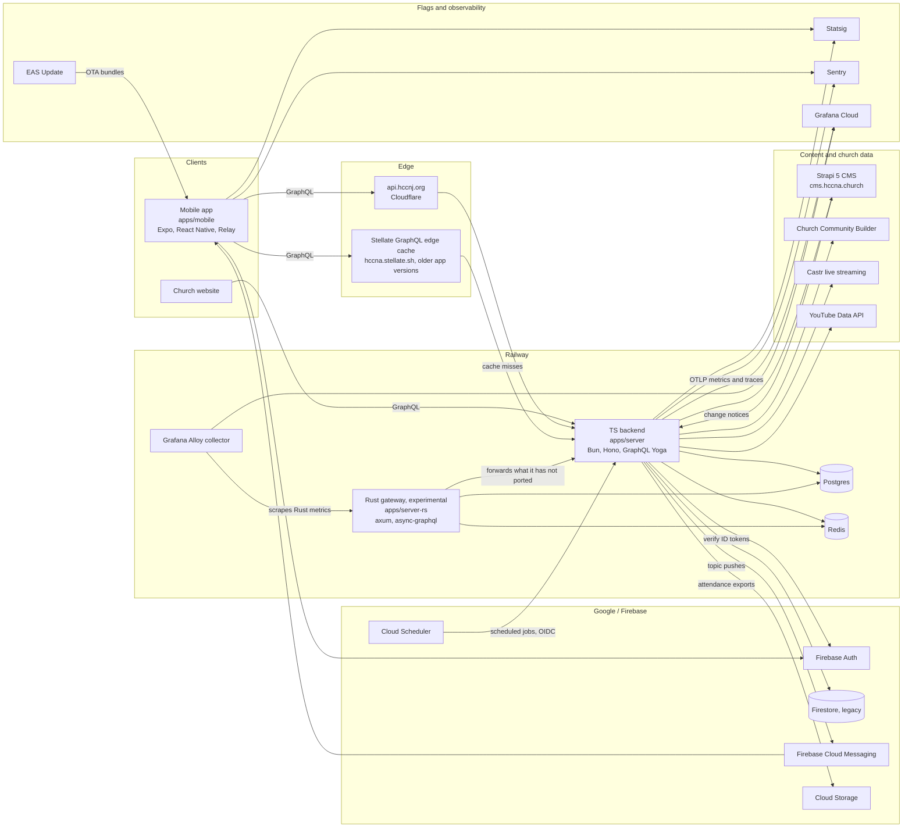
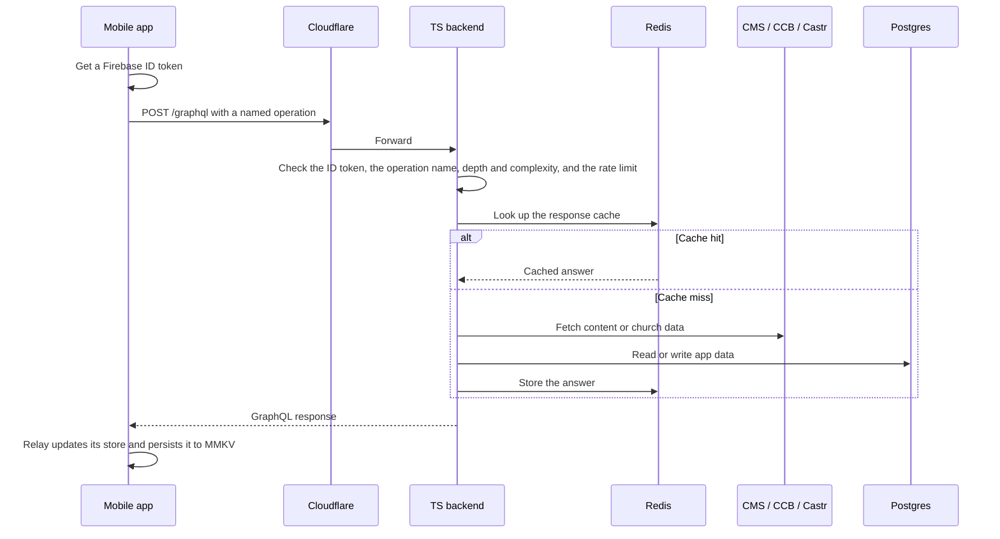

# System architecture

How the HCCNA app, its backend, and the services around them fit together. Hosting details
describe production at the time of this snapshot; this repository itself deploys nothing.

For code-level structure, see the [server architecture map](../apps/server/docs/architecture-map.md)
and the [mobile data flow](../apps/mobile/docs/architecture/data-flow.md).

## System context

## Components

| Component | Path | Built with | Responsibility |
|---|---|---|---|
| Mobile app | `apps/mobile` | Expo SDK 58, React Native, Relay, Effect, uniwind | The iOS and Android app. Relay is the client-side source of truth for server data, persisted to MMKV per signed-in user. |
| TS backend | `apps/server` | Bun, Hono, GraphQL Yoga, Pothos, Drizzle, Effect | The production API: GraphQL plus a small REST surface (`/v1/attendance-exports`), health checks, and a metrics server. |
| Rust gateway | `apps/server-rs` | axum, async-graphql | An experimental port heading to parity. It answers the queries it has ported and forwards everything else to the TS backend. No production client uses it. |
| GraphQL contract | `packages/schema` | SDL | `schema.graphql`, shared by both servers and the app; each runs its own codegen. |
| Integrations | `packages/castr`, `packages/ccb`, `packages/strapi-v2` | TypeScript, Effect | Clients for Castr, Church Community Builder, and the Strapi 5 CMS, used by the TS backend. |
| Tooling | `packages/config`, `packages/anti-slop`, `packages/mobile-lint` | TypeScript, Oxlint | Shared tsconfig bases and lint rules. |

## A typical request

## Data

- **Postgres** (Drizzle, `apps/server/src/db/schema`) holds the app's own data: users and
  their departments and ministries, campus subscription state, giving records and yearly
  summaries, event attendance and attendance exports, saved verses, scriptures, and stored CMS
  snapshots. Migrations are applied by hand, never on deploy.
- **Redis** holds the GraphQL response cache, service caches, and rate-limit counters.
- **Firestore** is legacy. The backend still reads and writes a few collections; new work does
  not add Firestore reads.
- **Strapi 5** is the source of content (campuses, events, sermons, featured cards). When
  editors publish, the CMS notifies the backend so it refreshes stored snapshots and drops
  cached answers ([CMS change notices](cms-change-notices.md)).
- **Church Community Builder** is the source of church records such as groups, attendance,
  and giving.

## Background work

- **Scheduled jobs.** Google Cloud Scheduler calls backend mutations on a timer, authenticated
  with Google-signed OIDC tokens: for example the monthly Word of Activation email and push,
  live-stream status polling, and campus subscription reconciliation.
- **Push notifications.** The backend subscribes registered devices to Firebase Cloud
  Messaging topics and sends to those topics.
- **OTA updates.** JavaScript-only changes reach installed apps through EAS Update when their
  native fingerprint matches ([OTA updates](ota-updates.md)).

## Feature flags and observability

- **Statsig** gates features in the app and the backend, including whether the Rust gateway
  answers anything itself.
- **Sentry** receives errors and traces from the app and both servers.
- **Grafana Cloud** receives the TS backend's metrics and traces over OTLP. A Grafana Alloy
  collector scrapes the Rust gateway's Prometheus metrics and forwards them.
